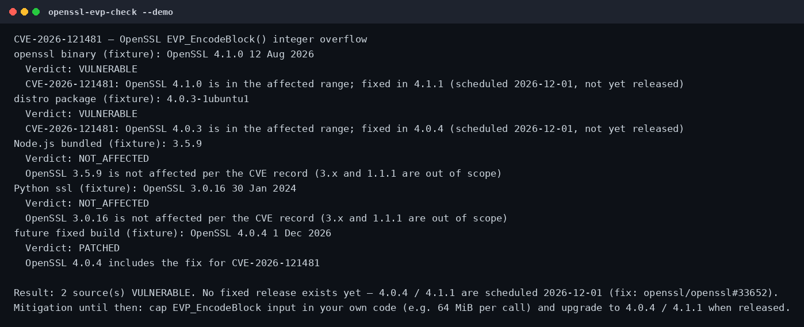

# openssl-evp-check



**Find out in 0.18 seconds whether any OpenSSL on your box is exposed to CVE-2026-121481. One command, no installs, no network calls.**

A stdlib-only Python CLI that reads every OpenSSL on the machine, the system binary, the distro package, the copy Node.js bundles, and the copy Python links, then gives each one a verdict: VULNERABLE, PATCHED, or NOT_AFFECTED. A real check takes a median **0.183 s** (7 live runs, measured 2026-11-21 on this machine). It runs offline and contains no exploit code. It only reads version strings.

## Why now

On **2026-11-18**, the OpenSSL project published **CVE-2026-121481**: an integer overflow in `EVP_EncodeBlock()`, the one-shot base64 encoder. Feed it an input length near INT_MAX, about 1.6 GB in a single call, and the encoded-output-size calculation overflows. The encoder then writes past the caller-supplied buffer, a heap buffer overflow. The fix is public pull request [#33652](https://github.com/openssl/openssl/pull/33652).

What the CVE record actually says:

- **Affected: OpenSSL 4.0.0 through 4.0.3, and 4.1.0.** Fixed in **4.0.4** and **4.1.1**.
- **No fixed release exists yet.** 4.0.4 and 4.1.1 are scheduled for **2026-12-01**. Until then, "upgrade to the fixed version" is advice about a version you cannot download.
- **OpenSSL 3.x and 1.1.1 are not affected**, per the CVE record. Debian 13 and Ubuntu 24.04 stay on 3.x, so they are clear.
- **The severity is disputed, and you should know that before you panic or shrug.** NVD and CISA enrichment score it CVSS 3.1 **9.8 Critical**. OpenSSL's own team rates it **Low**: no attacker-controlled path has been identified, because OpenSSL's TLS, QUIC, and CMS code never encodes buffers anywhere near that size. This checker reports which versions you have and lets you decide. It does not pick a side.
- **Distros already ship the affected builds** (checked 2026-11-20): Arch `openssl 4.1.0-1`, Fedora 45 `openssl 4.0.3-1.fc45`, Ubuntu 26.10 `openssl 4.0.3-1ubuntu1`, Homebrew `openssl@4 4.1.0`. Ubuntu's tracker also flags Node.js on Ubuntu 22.04, which embeds OpenSSL. That is why this tool checks the Node.js bundle too, not just the system binary.

Until the fixed releases ship, the practical move is to cap `EVP_EncodeBlock` input in your own code (64 MiB per call is a sane ceiling) and upgrade to 4.0.4 or 4.1.1 on 2026-12-01.

Sources: [OpenCVE record](https://app.opencve.io/cve/CVE-2026-121481) · [Fix PR openssl/openssl#33652](https://github.com/openssl/openssl/pull/33652) · [The CyberSec Guru explainer](https://thecybersecguru.com/exploits/cve-2026-121481-openssl-evp-encodeblock-overflow/) · [Cyber Security News](https://cybersecuritynews.com/openssl-heap-buffer-overflow/)

## Quick start (30 seconds)

```bash
git clone https://github.com/Mahgal/openssl-evp-check.git
cd openssl-evp-check
python3 openssl_evp_check.py              # check this machine
```

No pip installs, no dependencies. Python 3 only. Exit code 1 means something on the box is VULNERABLE, 0 means clean, 3 means nothing could be detected.

```bash
python3 openssl_evp_check.py --demo                      # labelled fixtures: 2 vulnerable, 1 patched, 2 not affected
python3 openssl_evp_check.py --version-string 4.0.3-1ubuntu1   # judge one version string
python3 openssl_evp_check.py --version-string 4.0.4            # PATCHED (the not-yet-released fix)
python3 openssl_evp_check.py --version-string 3.5.9            # NOT_AFFECTED
python3 openssl_evp_check.py --json                      # machine-readable output for CI
python3 openssl_evp_check.py --fail-on never             # report only, always exit 0
```

Verified from a clean copy (fresh checkout in `/tmp`, 2026-11-21): the live check runs, `--demo` reproduces byte-for-byte, and the full test suite passes, 44/44, exit 0.

## Example output

Real output of `python3 openssl_evp_check.py --demo` (captured verbatim to `demo.txt`; re-runs reproduce it byte-for-byte, sha256 `12fd954b68fbd5f703be4dbfcb7c0527d1ee8a0a2188d46532606ccd851e4b49`):

```
CVE-2026-121481 — OpenSSL EVP_EncodeBlock() integer overflow
openssl binary (fixture): OpenSSL 4.1.0 12 Aug 2026
  Verdict: VULNERABLE
  CVE-2026-121481: OpenSSL 4.1.0 is in the affected range; fixed in 4.1.1 (scheduled 2026-12-01, not yet released)
distro package (fixture): 4.0.3-1ubuntu1
  Verdict: VULNERABLE
  CVE-2026-121481: OpenSSL 4.0.3 is in the affected range; fixed in 4.0.4 (scheduled 2026-12-01, not yet released)
Node.js bundled (fixture): 3.5.9
  Verdict: NOT_AFFECTED
  OpenSSL 3.5.9 is not affected per the CVE record (3.x and 1.1.1 are out of scope)
Python ssl (fixture): OpenSSL 3.0.16 30 Jan 2024
  Verdict: NOT_AFFECTED
  OpenSSL 3.0.16 is not affected per the CVE record (3.x and 1.1.1 are out of scope)
future fixed build (fixture): OpenSSL 4.0.4 1 Dec 2026
  Verdict: PATCHED
  OpenSSL 4.0.4 includes the fix for CVE-2026-121481

Result: 2 source(s) VULNERABLE. No fixed release exists yet — 4.0.4 / 4.1.1 are scheduled 2026-12-01 (fix: openssl/openssl#33652).
Mitigation until then: cap EVP_EncodeBlock input in your own code (e.g. 64 MiB per call) and upgrade to 4.0.4 / 4.1.1 when released.
```

The demo shows the contrast in one screen: two VULNERABLE rows (4.1.0 and Ubuntu's 4.0.3) next to two NOT_AFFECTED rows (Node.js 3.5.9 and Python's 3.0.16) and a PATCHED row for the upcoming 4.0.4. The 4.0.4 row is a labelled fixture, a stand-in for the release scheduled 2026-12-01, included only to show what PATCHED looks like.

## What it checks

Four sources, each judged on its own, so a vulnerable Node.js bundle cannot hide behind a clean system binary:

| Source | How it is read |
| --- | --- |
| `openssl` binary | `openssl version` |
| Distro package | `dpkg-query` / `rpm` / `pacman` / `brew`, whichever is present |
| Node.js bundled OpenSSL | `node -p process.versions.openssl` |
| Python `ssl` | `ssl.OPENSSL_VERSION` |

Version parsing handles distro suffixes (`4.0.3-1ubuntu1`, `4.0.3-1.fc45`, `4.1.0-1`) and letter suffixes (`1.1.1w`). A version string that cannot be parsed becomes UNKNOWN, never a crash.

## Limitations

- This tool reads version strings. It does not scan the network, probe services, or run exploit code.
- It cannot see a statically linked OpenSSL hidden inside an arbitrary binary. It checks the four sources listed above and nothing else.
- A verdict of NOT_AFFECTED means the version is outside the CVE's affected ranges. It is not a guarantee that the library has no other flaw.
- The fix versions 4.0.4 and 4.1.1 do not exist yet. A PATCHED verdict on 4.0.4 or 4.1.1 today can only come from a fixture or a pre-release build.

## Tests

```bash
python3 tests/run_tests.py
```

44 tests, stdlib `unittest` only, no network. They cover every verdict boundary (4.0.3 vulnerable, 4.0.4 patched, 4.1.0 vulnerable, 4.1.1 patched, 3.5.9 and 1.1.1 not affected), distro-suffix and letter-suffix parsing, malformed versions mapping to UNKNOWN without crashing, the `--json` structure, all four exit codes, `--demo` determinism, and a no-OpenSSL environment degrading to exit 3.

## License

MIT. See [LICENSE](LICENSE).
